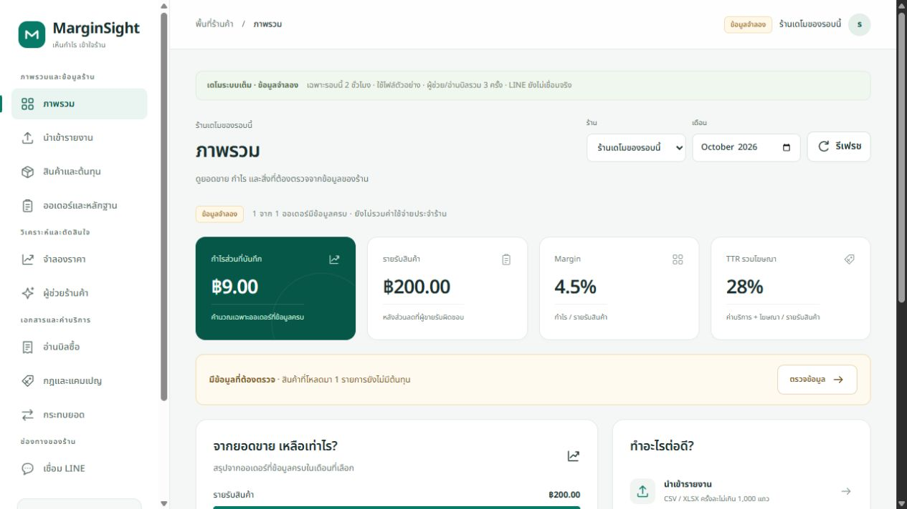

# MarginSight UI — 15 October 2026

## แนวทางที่ส่งมอบ

ปรับหน้าเริ่มต้น สร้างร้าน ลองคำนวณ และทั้ง 10 เมนูร้าน ให้ใช้ชุดสีเขียวอมฟ้า พื้นสว่าง ฟอร์ม การ์ด ตาราง และป้ายสถานะร่วมกัน รวมหน้า 404 และหน้ากู้คืนข้อผิดพลาดของ Next.js ด้วย

ใช้แนวทางจัดข้อมูลจาก shadcn/ui dashboard, FlowAccount และ sellerboard เป็นแรงบันดาลใจ เขียน CSS และ SVG ภายในโครงการ ไม่เพิ่ม Tailwind Plus หรือ dependency เชิงพาณิชย์ และไม่คัดลอกภาพ/โลโก้ของบริการอื่นมาเป็น UI สินค้า

- เมนูแบ่งเป็นข้อมูลร้าน วิเคราะห์ เอกสาร และช่องทาง; มือถือใช้ drawer มี focus trap, Escape, คืนโฟกัส และล็อกการเลื่อนพื้นหลัง
- Dashboard ให้กำไรส่วนที่บันทึกเด่น แสดง coverage และข้อมูลที่ต้องตรวจ แถบเปรียบเทียบมาจากผล API ที่มีจริง ไม่สร้างแนวโน้มย้อนหลังที่ยังไม่มีข้อมูล
- ตารางสินค้าและกระทบยอดเป็นการ์ดมีชื่อฟิลด์บนมือถือ; ตารางหลักฐานเลื่อนเฉพาะภายใน panel
- นำเข้า/OCR มีคำอธิบายขั้นตอนและ empty states; OCR draft เปลี่ยนจาก JSON เป็นตารางที่คนอ่านตรวจได้ ยังต้องยืนยันด้วยคน
- กฎและหลักฐานเข้าร่วมมีตัวเลือกประเภทแยกจากประเภทนำเข้า เพื่อไม่ส่งผิด endpoint; JSON ยังเป็นเครื่องมือสำหรับผู้ดูแลตามสัญญาข้อมูลเดิม
- วันเข้าร่วมแสดงตามวันประเทศไทยเช่นเดียวกับต้นทุน; สูตรคำนวณและการเก็บวันที่ backend คงเดิม
- ข้อมูล MOCK/REAL, ประมาณการ, ข้อมูลขาด และ LINE ที่ยังไม่ตั้งค่ามีข้อความกำกับ ไม่ใช้สีอย่างเดียว

หน้าล็อกอิน/สมัครที่ Amazon Cognito โฮสต์เองปรับสี ปุ่ม input และโลโก้ผ่าน classic branding ของ app client เดิม โครงฟอร์มและข้อความยังเป็นของ Cognito; ไม่เปลี่ยน auth policy, scopes, credentials หรือสิทธิ์ร้าน ใช้ `scripts/cloud-brand-auth.py` กับ `web/branding/` เพื่อทำซ้ำ และเก็บ customization เดิมใน `.local/cognito-ui-before.json` ของเครื่อง deploy ก่อนเปลี่ยน โค้ดนี้แยกจาก CloudFormation และต้องรันเมื่อสร้างบัญชี/stack ใหม่

## ผลตรวจในเครื่อง

- `node scripts/verify.mjs`: 43 backend tests, TypeScript, browser secret-pattern policy, bundled Lambda checks, production static export และ packaging ผ่าน หลังปรับหน้าหลัก; หลังเพิ่ม error/404 รัน web typecheck/build ผ่านซ้ำ
- Browser เปิดครบ 10 เมนูบนคอม และครบ 10 เมนูที่ 390px; ตรวจ scrollWidth ไม่เกิน clientWidth; เมนูปิดหลังเลือก และ Escape คืนโฟกัสที่ปุ่มเมนู
- Golden demo กำไร 9 บาท; ลด 15% ได้ -14.10 บาท และคุ้มทุนที่ระบบค้นได้ 188.31 บาท ไม่เปลี่ยนสูตร
- นำเข้า `orders.xlsx` ผ่านหน้าเว็บ รับ 1 แถว; นำเข้าไฟล์เดิมซ้ำเป็น duplicate 1 ไม่เพิ่มยอดซ้ำ
- เพิ่มสินค้า MOCK `UI-VERIFY`, บันทึกต้นทุน 154.50 บาทมีผล 15 ต.ค. และหลักฐาน MOCK ผ่านหน้าเว็บ; บันทึก enrollment `UI-CAMPAIGN` ผ่าน endpoint ที่แยกถูกต้อง
- หน้าลองคำนวณอ่านอย่างเดียวแสดงผลจริงจาก browser domain engine; ไม่ทำ fresh Cognito signup หรือสร้างร้านจริงเพิ่มในรอบนี้
- ช่วงทดสอบครั้งแรกเกิด `Failed to fetch` ระหว่าง dev reload; ตรวจ health และเลือกไฟล์ใหม่หลัง reload แล้ว positive/duplicate XLSX ผ่าน ไม่ใช้ความสำเร็จหลัง retry อ้างว่าไม่เคยเกิดปัญหา

หลักฐานภาพ/ผล AWS ล่าสุดและขอบเขตที่ยังไม่ได้ทดสอบอยู่ใน `status.md` / `verification.md`. สถานะทั้งโครงการยัง **PARTIAL_WITH_EXTERNAL_BLOCKERS**: LINE live, native marketplace samples และการประเมินบิลร้านจริงยังต้องมีข้อมูลภายนอก

## ผลบน AWS — 15 ตุลาคม 2026

- เว็บเผยแพร่จาก `ad7bb9f` บน S3/CloudFront เดิม; health ผ่าน และเปิดร้าน guest MOCK ใหม่ได้ กำไร9บาท/ส่วนลด15%ขาดทุน14.10บาท
- เปิดครบ10เมนูบนเว็บจริง ไม่พบ Failed to fetch ในรอบตรวจ; บาง operation/ฟอร์มยังตรวจในเครื่องตามรายการข้างบน ไม่อ้างว่า submit ทุก operation บน AWS ครบแล้ว
- อัปโหลด `orders.xlsx` ผ่านเว็บจริงสำเร็จ รับ1 แถว/ซ้ำ0/ผิด0/ขัดแย้ง0 ผ่าน S3/worker เดิม ไม่ใช่การ invoke worker แทน browser
- Cognito branding จาก `26ad3e6` apply/read-back ผ่าน; CSSVersion `20261015071504`; ตรวจหน้า signup และ sign-in จริง เห็นโลโก้และปุ่มสี `rgb(8,123,104)` สูง44px ไม่กรอก credentials หรือสร้างบัญชีเพิ่ม
- รูปด้านล่างเป็นข้อมูล MOCK ของ guest บนเว็บ AWS ไม่มีข้อมูลร้านจริงหรือ credential

## แหล่งอ้างอิงดีไซน์

- [shadcn/ui Dashboard](https://ui.shadcn.com/examples/dashboard)
- [FlowAccount Dashboard](https://flowaccount.com/help-center/category/dashboard/guide-business-dashboard)
- [sellerboard Profitability Dashboard](https://blog.sellerboard.com/2025/06/28/mastering-sellerboards-profitability-dashboard-tiles-charts-pl-map-and-trends/)
